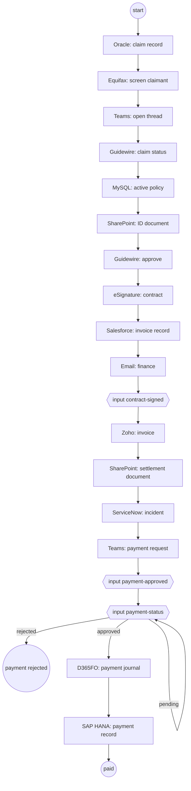

# Claim Settlement Phylum

The phylum settles one insurance claim per run of a single defflow,
`claim`, in [claim.lisp](claim.lisp).  The run id is the claim id.

## Why one defflow

The process waits on 16 connector replies and 3 people or systems.  Before,
it was five workflows on a hand-built state machine, with a stage per state
and an entry point per workflow.  defflow keeps the run's locals between
transactions, refuses an input the run is not waiting for, and keys each
connector request for idempotency.  So the process reads top to bottom in
`claim.lisp`, and none of that machinery is in this repo.

## Files

| File | What it holds |
| --- | --- |
| [main.lisp](main.lisp) | Package, service version, and the load order |
| [routes.lisp](routes.lisp) | `init` and `healthcheck` |
| [claim-steps.lisp](claim-steps.lisp) | Demo settings, and for each step a function that builds the connector event and one that reads the reply |
| [claim.lisp](claim.lisp) | The `claim` flow and its `reply` macro |
| [claim-steps_test.lisp](claim-steps_test.lisp) | Unit tests of each builder and reader |
| [claim_test.lisp](claim_test.lisp) | Flow tests that drive whole runs |
| [claim_testhelpers.lisp](claim_testhelpers.lisp) | The mocked replies and a driver for the flow tests |

Tests and test helpers are not in the phylum zip (`common.phylum.mk`).

## The steps



Each connector step goes through the `reply` macro.  It sends the event,
waits, and calls the step's reader on the reply.  A reader raises
`bad-reply` when the reply lacks what a later step needs, and the macro
fails the run with that reason.  Without the macro the error would fail
the reply's transaction; the hub does not resend a reply, so the run
would wait until its one-hour connector timeout and fail with a bare
"timeout".

Rules the steps apply:

- A start request needs `policy_id`, `guidewire_claim_id`,
  `invoice_amount`, `signer_name`, `signer_email`,
  `settlement_document_item_id` and `settlement_document_filename`.
  Without them the start is rejected and no run is written.
- The settlement document is the SharePoint file the start request
  names, in the demo document library.  A request that names the ID
  document there is rejected: the demo once fetched the ID document
  twice and gave it to ServiceNow as the settlement document (#37).
  When SharePoint names the file it read, it must be that file.  The
  ServiceNow incident names the file for its reviewers.
- The invoice may not exceed the Oracle claim `AMOUNT` or the policy's
  `COVERAGE_LIMIT`; both apply, so the lower one wins.  A cap that is
  missing or not a number fails the run too.  Both checks run before
  Guidewire marks the claim for settlement.  An invoice amount has at
  most two decimal places, so the float comparison cannot round it down
  to a cap it exceeds.
- The Guidewire claim must be `Open`, `UnderReview` or `Approved`.
  `Rejected`, `Closed` and any status the flow does not know fail the
  run.
- The Equifax screening passes when the status is `Clear` with no PEP or
  embargo hit.  Otherwise the Teams thread says why, and the claim goes
  on: the review happens in Teams.
- The ID document must name the claim id that Oracle returned.
- Every SQL value is a bound arg (`:1` for Oracle, `?` for MySQL and SAP
  HANA), never SQL text, so no value needs quoting.
- The flow needs connectorhub v0.0.29.SNAPSHOT.13 or later: older hubs
  drop bound args and refuse Zoho `create_invoice` and ServiceNow
  `create_incident`.

## Endpoints

defflow generates them:

| Endpoint | Args |
| --- | --- |
| `claim_start` | `request_key req` |
| `claim_get` | `run_id` |
| `claim_contract_signed` | `run_id input gen [request_key]` |
| `claim_payment_approved` | `run_id input gen [request_key]` |
| `claim_payment_status` | `run_id input gen [request_key]` |

Starts and inputs are taken from `Org1MSP` only.  An input needs the
run's current `gen`, so the portal reads `claim_get` before it sends one
(see [portal/oracle/endpoints.go](../portal/oracle/endpoints.go)).
`claim_get` exposes the claim's request with its defaults as
`vars.claim`.

## Testing

```sh
make test
```

This runs `shirotester unit-tests --verbose .` in the substrate
`SHIROTESTER_VERSION` image.  The flow tests use `flow-test` from
substrate: `flow-test:reply` answers the connector step a run waits at,
and `flow-test:input` sends an input with the run's current generation.
To see the flow as a graph:

```sh
shirotester flow-graph .
```
